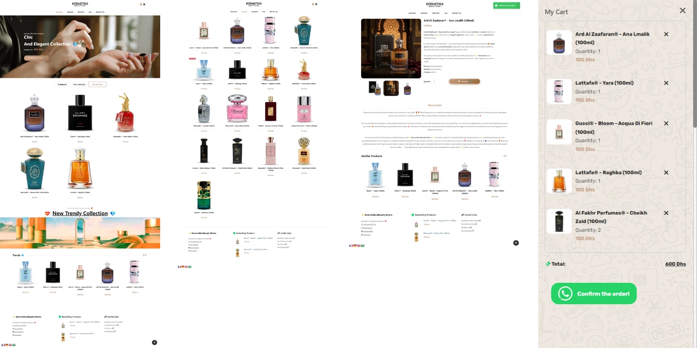
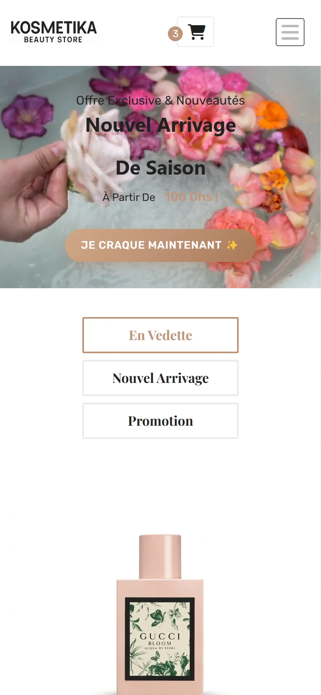
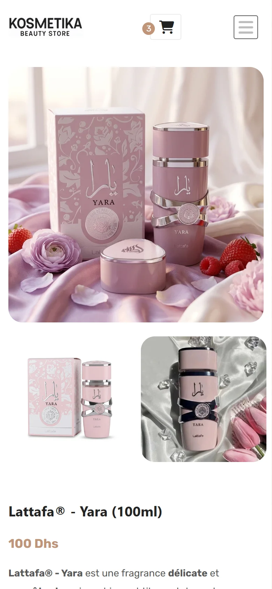
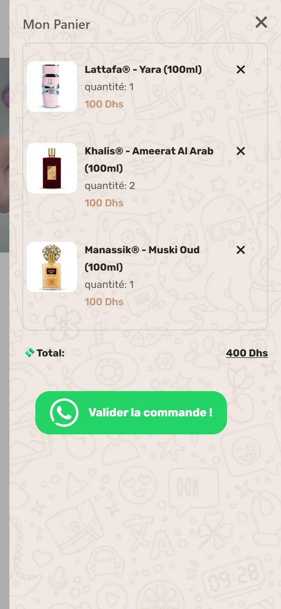

<div align="center">

🌐 [Français](README.md) · **English**


# Kosmetika Beauty Store

**The perfume shop that fits in a folder.**<br>
No server. No database. Orders land straight in WhatsApp.

<a href="https://hicham-o-sfh.github.io/Kosmetika-Beauty-Store/" target="_blank" rel="noopener"><b>▶ Visit the live store</b></a>



</div>

---

## 💡 The concept

Kosmetika is a **portfolio project**: a complete perfume shop, built as if for a real merchant.
The brief is deliberately realistic: **17 products**, a catalogue that changes a few times a
year, and customers who **already order on WhatsApp**.

The question was never "which stack?". It was: **what does this shop actually need?** Answer:
far less than you'd think. The most interesting engineering here is **everything I chose not
to build**.

## ✨ What you can do

- 🛍️ **Browse the catalogue**: featured, new arrivals, deals, sold-out items flagged.
- 🔍 **Open a product page** with gallery and zoom, shareable with a plain link.
- 🛒 **Fill a cart** that survives closing the tab.
- 💬 **Order in one tap**: the cart becomes a WhatsApp message, ready to send.
- 🌍 **Switch language** on the fly: French, English, German, Arabic.
- 📱 **On desktop and on phone**, mobile-first.

<p align="center">
  
  
</p>

<p align="center">
  
  
</p>

<p align="center">
  
  
  
</p>

---

## 💬 WhatsApp checkout: zero friction

No account to create, no form, no credit card. One tap on **"Valider la commande !"** and
WhatsApp opens with the invoice already written:

```text
- (Lattafa® - Yara (100ml)) x 1 = (100 Dhs) x 1
- (Khalis® - Ameerat Al Arab (100ml)) x 2 = (100 Dhs) x 2
- (Manassik® - Muski Oud (100ml)) x 1 = (100 Dhs) x 1

 --------------------------------------------------
	 Total = 400 Dhs
```

The order lands **where the shop already answers every day**. No payment gateway, no sign-up
wall to abandon. And the customer history? It's the conversation itself, searchable by phone
number, on the device the merchant already carries.

**The site's most important feature is also the one with the least code behind it.**

## ⚡ No backend, and proud of it

**17 products isn't a database, it's a file.** The catalogue lives in `products.js`, the photos
in a folder. Putting an API and a database in front of 17 objects means paying for a server to
provision, patch, monitor and back up… for nothing an array doesn't already do.

**Product pages without a router.** Each card links to `product-details.html?productId=16`: the
page reads the URL, finds the product and fills itself in. Shareable link, one page per product,
no server in the path.

**What that buys:**

| | |
|---|---|
| 💸 Hosting | **€0** on GitHub Pages |
| 🚀 Deployment | `git push`, that's it |
| 🧰 Build | none: no npm, no bundler |
| 🪶 Weight | ~80 KB of CSS, ~75 KB of application JavaScript |
| 🔧 Maintenance | no server, no database, no bill at the end of the month |

## 🛡️ Security by subtraction

**You can't hack what doesn't exist.** No server, no database, no accounts, no passwords, no
admin panel: no SQL injection, no credential leak, no login to brute-force, no midnight
security patching.

There is **no server-side price to tamper with**: the order is a message the merchant reads and
confirms. No online payment, so no PCI-DSS scope. And no customer data stored, so nothing to leak.

The **only** writable surface in the whole system: two Firestore counters per product
(`total_orders`, `total_quantity`), locked down twice over:

- 🔒 **Firebase App Check** (reCAPTCHA v3): only the real store, on its own domain, can write.
- 📜 **Strict Firestore rules** ([`firestore.rules`](firestore.rules)): two integers that only
  move forward, by amounts a real cart can produce. Every other path is closed.

Firebase is **optional**: its only job is knowing *what sells*. The day it stops paying for
itself, it comes out in one commit and the shop keeps selling.

---

## 🛠️ Under the hood

- **HTML, CSS, JavaScript** as native ES modules, **zero build step**.
- **Bootstrap 5**, **jQuery** and its plugins: Slick and Owl Carousel (carousels), elevateZoom
  (zoom), Notyf (notifications), GTranslate (languages), Font Awesome (icons).
- **Firebase Firestore + App Check** (reCAPTCHA v3) for the order counters.
- **Site-level SEO**: unique titles and descriptions, `canonical`, Open Graph, `robots.txt`,
  `sitemap.xml`.
- **Accessibility**: alt text, real buttons, visible keyboard focus.
- 🎨 The main product visuals are **AI-generated**, then normalised to 1024×1024 WebP.

## ⚖️ The limits, owned

A trade-off, not a shortcut. Here's what it costs, plainly:

- 🔎 **Product page SEO**: they share one parameterised URL, filled in by JavaScript, so Google
  doesn't index them one by one. Site-level SEO is done. The fix exists (a small script that
  generates one HTML page per product before deploying), and it's only worth it the day Google
  search becomes a real acquisition channel.
- 📦 **Past a hundred products or so**, the catalogue will want pagination and a real index.
- 💳 **Card payments or live stock** would genuinely need a backend.

Until then, a backend would be paying rent on complexity the shop doesn't have.

---

## 🚀 Run it locally

```bash
git clone https://github.com/hicham-o-sfh/Kosmetika-Beauty-Store.git
```

Open the folder in VS Code, then right-click `index.html` → **Open with Live Server**
([Live Server](https://marketplace.visualstudio.com/items?itemName=ritwickdey.LiveServer)
extension). Not `file://`: browsers block ES modules there.

Catalogue, cart and WhatsApp checkout work right away. The Firebase counters stay refused
locally: `localhost` isn't a domain App Check allows, on purpose.

<details>
<summary><b>Plug in your own Firebase (optional)</b></summary>

1. Replace the values in
   [`assets/js/app/config/firebase.config.js`](assets/js/app/config/firebase.config.js) with your
   project's and your reCAPTCHA v3 key;
   [`firebase.config.example.js`](assets/js/app/config/firebase.config.example.js) says where each
   value comes from. This file is committed on purpose: GitHub Pages serves the repository as is,
   and Firebase keys are public by design. App Check is what protects it.
2. Point [`.firebaserc`](.firebaserc) at your project, then deploy the rules:

   ```bash
   npx --yes firebase-tools login
   ```

   ```bash
   npx --yes firebase-tools deploy --only firestore:rules
   ```

3. Turn on App Check enforcement for Cloud Firestore in the Firebase console.

Without a valid config, only the counters switch off: the rest of the store is unchanged.

</details>

## 🗂️ Layout

```
index.html, shop.html, product-details.html    the store pages
services.html, faq.html, contact-us.html
assets/css/                                    site styles + library bundle
assets/js/app/data/products.js                 the catalogue
assets/js/app/services/                        the cart
assets/js/app/ui/                              templates and plugins
assets/js/app/firebase-management.js           order counters (Firebase)
assets/js/vendor/                              third-party libraries, untouched
firestore.rules                                Firestore security rules
```

---

## 📄 License

The original code of this project is released under the [MIT License](LICENSE): clone it,
modify it, reuse it, as long as the copyright notice is kept.

**The MIT license covers** the application JavaScript in `assets/js/app/`, the page markup
written or modified for this project, the documentation and the repository layout.

**It does not cover:**

- the **third-party libraries** in `assets/js/vendor/` (jQuery, Bootstrap, Popper, Slick,
  Owl Carousel, elevateZoom, Notyf, Modernizr, GTranslate), each under its own license;
- the **brand and content**: the _Kosmetika_ name and logo, the product visuals and the store
  copy are © Hicham Oussama Saffih and are **not** licensed for reuse. Perfume and brand names
  belong to their respective owners.

In short: reuse the code, bring your own theme, your own visuals and your own brand.

---

<div align="center">

Designed and built by **Hicham Oussama Saffih**.

</div>
