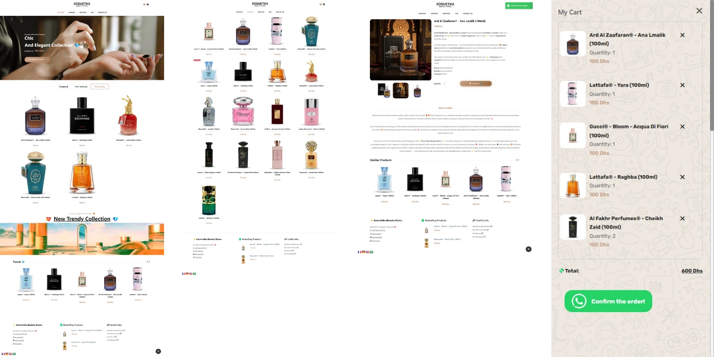
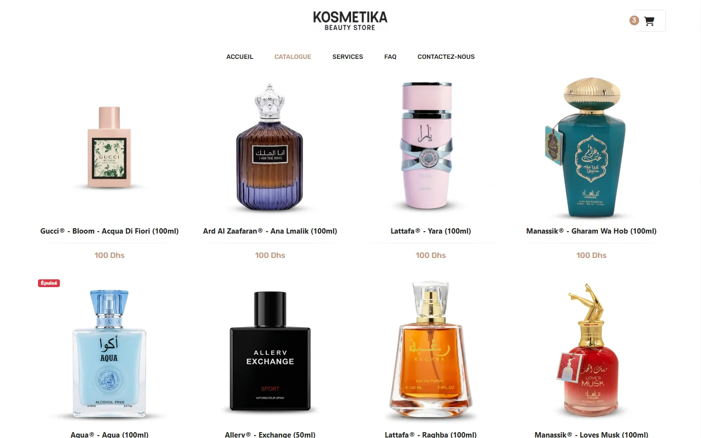
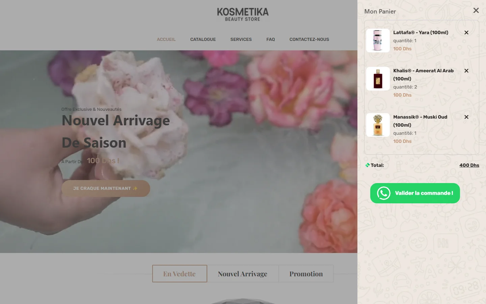
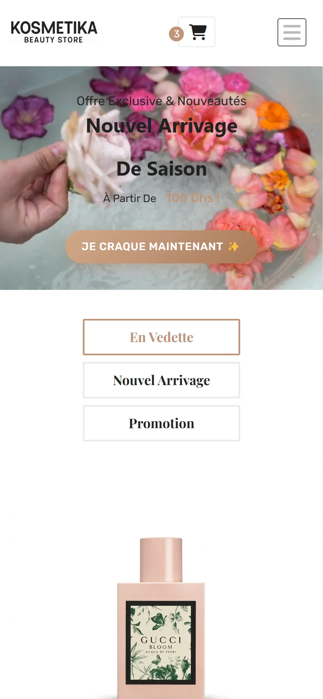
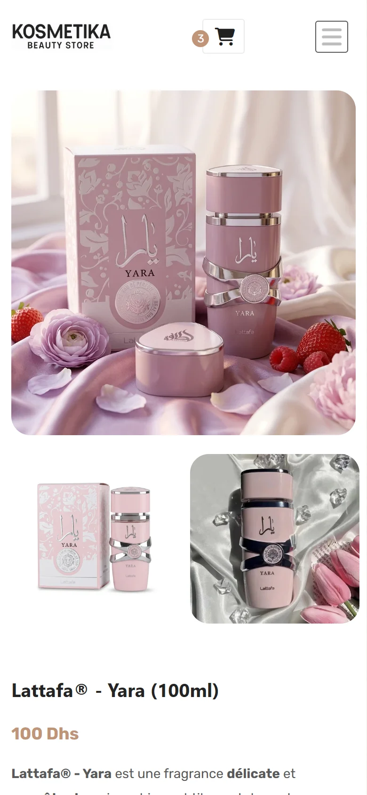
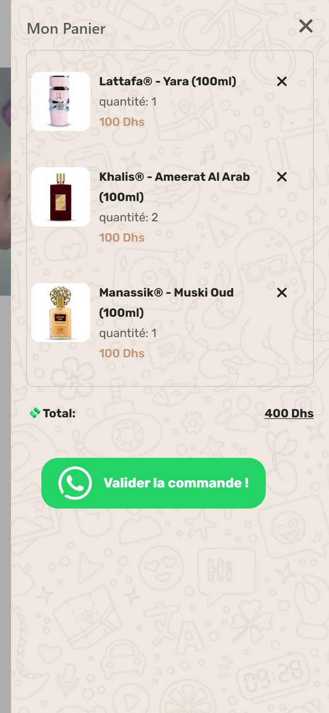

<div align="center">

🌐 **Français** · [English](README.en.md)


# Kosmetika Beauty Store

**La boutique de parfums qui tient dans un dossier.**<br>
Pas de serveur. Pas de base de données. Des commandes qui tombent directement sur WhatsApp.

<a href="https://hicham-o-sfh.github.io/Kosmetika-Beauty-Store/" target="_blank" rel="noopener"><b>▶ Voir la boutique en ligne</b></a>



</div>

---

## 💡 Le concept

Kosmetika est un **projet portfolio** : une boutique de parfums complète, construite comme pour
un vrai commerçant. Le brief est volontairement réaliste : **17 références**, un catalogue qui
bouge quelques fois par an, et des clientes qui **commandent déjà sur WhatsApp**.

La question n'a jamais été « quelle stack ? ». C'était : **de quoi cette boutique a-t-elle
vraiment besoin ?** Réponse : de beaucoup moins que ce qu'on croit. Le plus intéressant ici,
c'est **tout ce que j'ai choisi de ne pas construire**.

## ✨ Ce qu'on peut faire

- 🛍️ **Parcourir le catalogue** : en vedette, nouveautés, promotions, produits épuisés signalés.
- 🔍 **Ouvrir une fiche produit** avec galerie et zoom, partageable par un simple lien.
- 🛒 **Remplir son panier**, qui survit à la fermeture de l'onglet.
- 💬 **Commander en un tap** : le panier devient un message WhatsApp prêt à envoyer.
- 🌍 **Changer de langue** à la volée : français, anglais, allemand, arabe.
- 📱 **Sur ordinateur comme sur téléphone**, mobile-first.

<p align="center">
  
  
</p>

<p align="center">
  
  
</p>

<p align="center">
  
  
  
</p>

---

## 💬 Le checkout WhatsApp : zéro friction

Pas de compte à créer, pas de formulaire, pas de carte bancaire. Un tap sur **« Valider la
commande ! »** et WhatsApp s'ouvre avec la facture déjà rédigée :

```text
- (Lattafa® - Yara (100ml)) x 1 = (100 Dhs) x 1
- (Khalis® - Ameerat Al Arab (100ml)) x 2 = (100 Dhs) x 2
- (Manassik® - Muski Oud (100ml)) x 1 = (100 Dhs) x 1


 --------------------------------------------------
	 Total = 400 Dhs
```

La commande arrive **là où la boutique répond déjà tous les jours**. Pas de passerelle de
paiement, pas de tunnel d'inscription à abandonner. Et l'historique client ? C'est la
conversation elle-même, consultable par numéro, sur le téléphone que le commerçant a déjà en poche.

**La fonctionnalité la plus importante du site est aussi celle qui a le moins de code.**

## ⚡ Sans backend, et fier de l'être

**17 produits, ce n'est pas une base de données, c'est un fichier.** Le catalogue vit dans
`products.js`, les photos dans un dossier. Mettre une API et une base devant 17 objets, c'est
payer un serveur à installer, patcher, surveiller et sauvegarder… pour rien qu'un tableau ne
fasse déjà.

**Des fiches produit sans routeur.** Chaque carte pointe vers
`product-details.html?productId=16` : la page lit l'URL, retrouve le produit et se remplit.
Lien partageable, une page par produit, aucun serveur sur le chemin.

**Ce que ça rapporte :**

| | |
|---|---|
| 💸 Hébergement | **0 €** sur GitHub Pages |
| 🚀 Déploiement | `git push`, c'est tout |
| 🧰 Build | aucun : pas de npm, pas de bundler |
| 🪶 Poids | ~80 Ko de CSS, ~75 Ko de JavaScript applicatif |
| 🔧 Maintenance | pas de serveur, pas de base, pas de facture à la fin du mois |

## 🛡️ La sécurité par soustraction

**On ne peut pas pirater ce qui n'existe pas.** Pas de serveur, pas de base de données, pas de
comptes, pas de mots de passe, pas de back-office : pas d'injection SQL, pas de fuite
d'identifiants, pas de login à forcer, pas de patch de sécurité en pleine nuit.

Il n'y a **pas de prix côté serveur à falsifier** : la commande est un message que le commerçant
lit et confirme. Pas de paiement en ligne, donc rien à voir avec PCI-DSS. Et aucune donnée
client stockée, donc rien à fuiter.

La **seule** surface en écriture de tout le système : deux compteurs Firestore par produit
(`total_orders`, `total_quantity`), verrouillés à double tour :

- 🔒 **Firebase App Check** (reCAPTCHA v3) : seule la vraie boutique, sur son propre domaine,
  peut écrire.
- 📜 **Règles Firestore strictes** ([`firebase/firestore.rules`](firebase/firestore.rules)) : deux entiers, qui ne
  font qu'avancer, et seulement des quantités qu'un vrai panier peut produire. Tout le reste
  est fermé.

Firebase est **optionnel** : il ne sert qu'à savoir *ce qui se vend*. Le jour où il ne sert plus,
on l'enlève en un commit et la boutique continue de vendre.

---

## 🛠️ Côté technique

- **HTML, CSS, JavaScript** en modules ES natifs, **zéro étape de build**.
- **Bootstrap 5**, **jQuery** et ses plugins : Slick et Owl Carousel (carrousels), elevateZoom
  (zoom), Notyf (notifications), GTranslate (langues), Font Awesome (icônes).
- **Firebase Firestore + App Check** (reCAPTCHA v3) pour les compteurs de commandes.
- **SEO de site** : titres et descriptions uniques, `canonical`, Open Graph, `sitemap.xml`.
- **Accessibilité** : textes alternatifs, vrais boutons, focus visible au clavier.
- 🎨 Les visuels produit principaux sont **générés par IA**, puis normalisés en WebP 1024×1024.

## ⚖️ Les limites, assumées

Un choix, pas un raccourci. Ce qu'il coûte, en clair :

- 🔎 **SEO des fiches produit** : elles partagent une même URL à paramètre, remplie en
  JavaScript, donc Google ne les indexe pas une par une. Le SEO du site, lui, est fait. Le
  remède existe (un petit script qui génère une page HTML par produit avant le déploiement),
  et il ne vaut le coup que le jour où la recherche Google devient un vrai canal d'acquisition.
- 📦 **Au-delà d'une centaine de produits**, le catalogue voudra une pagination et un vrai index.
- 💳 **Paiement par carte ou stock en temps réel** demanderaient un vrai backend.

D'ici là, un backend, ce serait payer le loyer d'une complexité que la boutique n'a pas.

---

## 🚀 Lancer en local

```bash
git clone https://github.com/hicham-o-sfh/Kosmetika-Beauty-Store.git
```

Ouvrir le dossier dans VS Code, puis clic droit sur `index.html` → **Open with Live Server**
(extension [Live Server](https://marketplace.visualstudio.com/items?itemName=ritwickdey.LiveServer)).
Pas de `file://` : les navigateurs y bloquent les modules ES.

Catalogue, panier et checkout WhatsApp marchent tout de suite. Les compteurs Firebase, eux,
restent refusés en local : `localhost` n'est pas un domaine autorisé par App Check, c'est voulu.

<details>
<summary><b>Brancher votre propre Firebase (optionnel)</b></summary>

1. Remplacer les valeurs de
   [`assets/js/app/config/firebase.config.js`](assets/js/app/config/firebase.config.js) par celles
   de votre projet et votre clé reCAPTCHA v3 ;
   [`firebase.config.example.js`](assets/js/app/config/firebase.config.example.js) indique d'où
   vient chaque valeur. Ce fichier est commité exprès : GitHub Pages sert le dépôt tel quel, et
   les clés Firebase sont publiques par nature. C'est App Check qui protège.
2. Pointer [`firebase/.firebaserc`](firebase/.firebaserc) vers votre projet, puis déployer les
   règles depuis le dossier `firebase/` :

   ```bash
   cd firebase
   ```

   ```bash
   npx --yes firebase-tools login
   ```

   ```bash
   npx --yes firebase-tools deploy --only firestore:rules
   ```

3. Activer l'application d'App Check pour Cloud Firestore dans la console Firebase.

Sans configuration valide, seuls les compteurs s'éteignent : le reste de la boutique ne change pas.

</details>

## 🗂️ Organisation

```
index.html, shop.html, product-details.html    les pages de la boutique
services.html, faq.html, contact-us.html
assets/css/                                    style du site + bundle des librairies
assets/js/app/data/products.js                 le catalogue
assets/js/app/services/                        le panier
assets/js/app/ui/                              gabarits et plugins
assets/js/app/firebase-management.js           compteurs de commandes (Firebase)
assets/js/vendor/                              librairies tierces, non modifiées
firebase/                                      règles Firestore et config de la CLI Firebase
```

---

## 📄 Licence

Le code original de ce projet est sous [licence MIT](LICENSE) : clonez-le, modifiez-le,
réutilisez-le, en gardant la mention de copyright.

**La licence MIT couvre** le JavaScript applicatif de `assets/js/app/`, le balisage des pages
écrit ou modifié pour ce projet, la documentation et l'organisation du dépôt.

**Elle ne couvre pas :**

- les **librairies tierces** de `assets/js/vendor/` (jQuery, Bootstrap, Popper, Slick,
  Owl Carousel, elevateZoom, Notyf, Modernizr, GTranslate), chacune sous sa propre licence ;
- la **marque et le contenu** : le nom et le logo _Kosmetika_, les visuels produit et les textes
  de la boutique sont © Hicham Oussama Saffih et **ne sont pas** réutilisables. Les noms de
  parfums et de marques appartiennent à leurs propriétaires.

En bref : reprenez le code, apportez votre thème, vos visuels et votre marque.

---

<div align="center">

Conçu et développé par **Hicham Oussama Saffih**.

</div>
